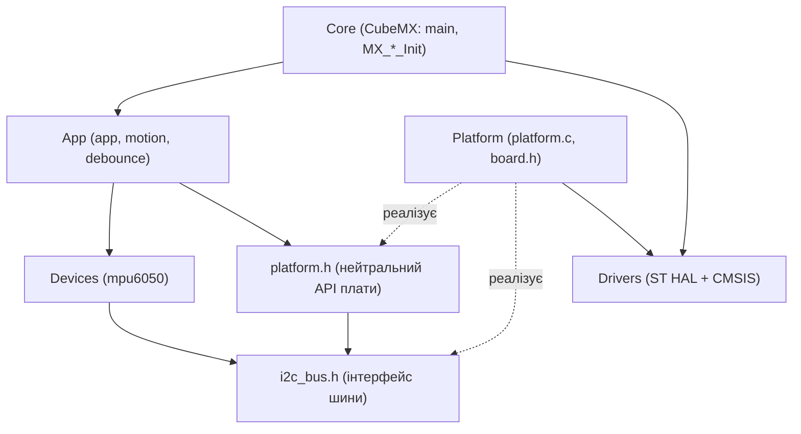

# Архітектура прошивки

## Шари

```
firmware/
├── Core/        код CubeMX (main.c, ініціалізація I2C/UART/GPIO, IRQ); у main.c змінено лише блоки USER CODE
├── Drivers/     ST HAL + CMSIS (не редагуються), HAL v1.0.1 для STM32C0
├── Platform/    адаптація до плати: піни (board.h), обгортки над HAL (platform.c), нейтральний інтерфейс (platform.h)
├── Devices/     драйвер MPU-6050; залежить лише від інтерфейсу шини i2c_bus.h
└── App/         логіка продукту: фільтр кутів, підсилення, мертва зона, антидребезг, самотест; про HAL не знає
tests/           хостові тести (звичайний gcc), підроблені шина та платформа
scripts/         check_deps.py (перевірка залежностей), patch_main.py, dev.ps1
```

## Component diagram



Пунктир означає «реалізує інтерфейс», суцільна стрілка означає «включає заголовок / залежить».

## Правила залежностей

| Шар | Має право підключати | Не має права |
|---|---|---|
| Devices | стандартні заголовки, заголовки Devices (`i2c_bus.h`, `mpu6050.h`) | HAL, CMSIS, `main.h`, Platform, App |
| App | стандартні заголовки, App, Devices, `platform.h` | HAL, CMSIS, `main.h`, інші заголовки Platform (`board.h`) |
| Platform | HAL, `main.h`, `i2c_bus.h` | - |

Правила перевіряє `scripts/check_deps.py`: він проглядає `#include` у `firmware/Devices` та `firmware/App` і завершується з кодом 1 при порушенні. Скрипт запускається командою `scripts/dev.ps1 check` (або `make check`) і в CI на кожен pull request. Перевірено негативним тестом: навмисне додавання `#include "stm32c0xx_hal.h"` у `motion.h` та `#include "board.h"` у `mpu6050.c` дає порушення й код виходу 1.

## Як драйвер працює без HAL

Драйвер MPU-6050 отримує вказівник на структуру `i2c_bus_t` (функції `write`, `read` і контекст `ctx`). На платі `Platform/platform.c` підставляє функції, які викликають `HAL_I2C_Master_Transmit/Receive`. У хостових тестах підставляється `tests/fakes/fake_i2c.c`. Один і той самий код драйвера виконується в обох випадках.

Регістр читається двома транзакціями (запис адреси регістра зі STOP, потім читання): `HAL_I2C_Mem_Read` у моделі I2C симулятора Wokwi не формує repeated START.

## Де знання про плату

Усі прив'язки «функція - пін - периферія» зібрані в `Platform/board.h` (у коментарі таблиця) і відповідають `docs/pinout.md`. Хендли периферії ADC і TIM створюються в `platform.c`, хендли I2C та UART у `Core/Src/main.c` (їх створює CubeMX).

## Код CubeMX і повторна генерація

`firmware.ioc` описує I2C1, USART2 і GPIO. ADC1 і TIM3 свідомо ініціалізуються в `Platform/platform.c`, а не через CubeMX: код поза `Core/` повторна генерація не змінює. Зміни в `Core/Src/main.c` обмежені трьома місцями всередині `USER CODE BEGIN/END` (підключення заголовків, виклик `app_init()`, виклик `app_step()` у циклі). Їх вносить скрипт `scripts/patch_main.py`, він ідемпотентний.

## Відмінності від рекомендованого шаблону з методички

- Немає каталогу `Middlewares/`: сторонніх бібліотек і RTOS немає.
- Основний цикл без RTOS, неблокуючий (`app_step`), плануються за `HAL_GetTick` (період вибірки датчика 5 мс).
- Тестовий каркас власний мінімальний (макроси `CHECK`, `CHECK_EQ`, `CHECK_NEAR`) замість Unity/CMock: зовнішні залежності не потрібні, а збірка в Docker лишається простою. Втрачено: автоматична генерація mock-ів і формальне порівняння послідовності викликів, тому послідовність транзакцій перевіряється вручну через журнал підробленої шини.

## Збірка та версії

- Тулчейн у Docker-образі `stm32-build` (Ubuntu 22.04, `gcc-arm-none-eabi`, `gcc` для тестів).
- Власний код збирається з `-Wall -Wextra -Werror` (Devices, App) та `-Wextra` (Platform); вендорські заголовки підключаються через `-isystem`, їхні попередження придушені навмисно.
- Версія HAL: STM32C0xx HAL driver **v1.0.1** (визначена порівнянням файлів з тегами репозиторію `STMicroelectronics/stm32c0xx_hal_driver`; ADC, TIM і LL-заголовки додані з того ж тегу).
- Розмір прошивки: text ≈ 27,6 КБ з 32 КБ Flash.
