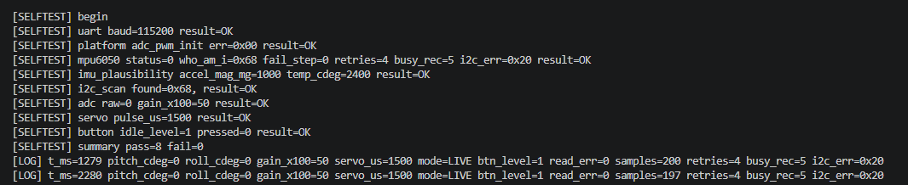
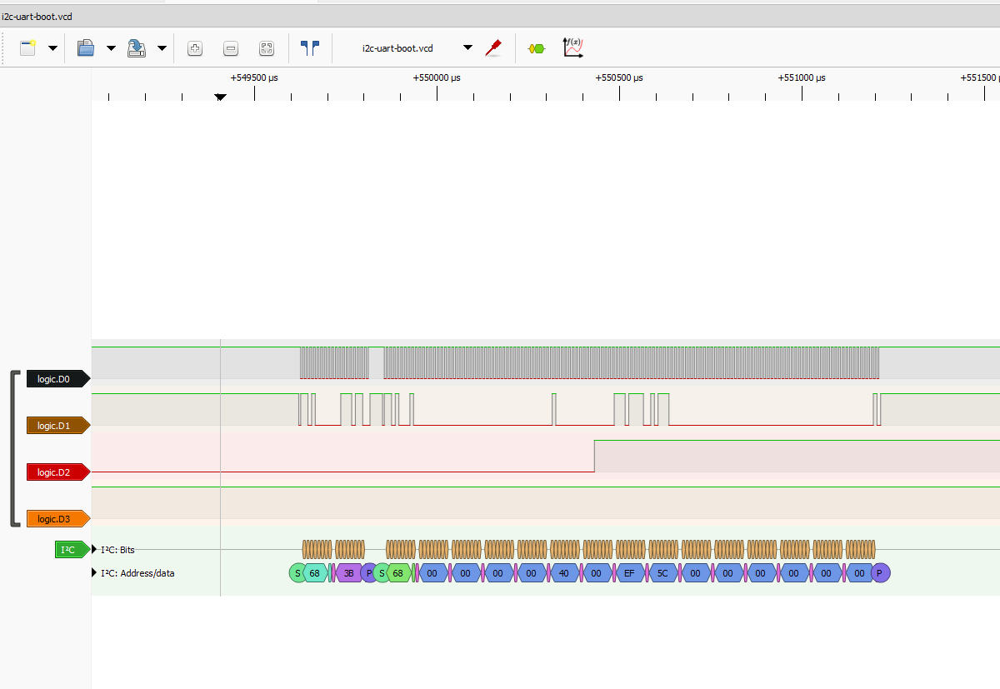
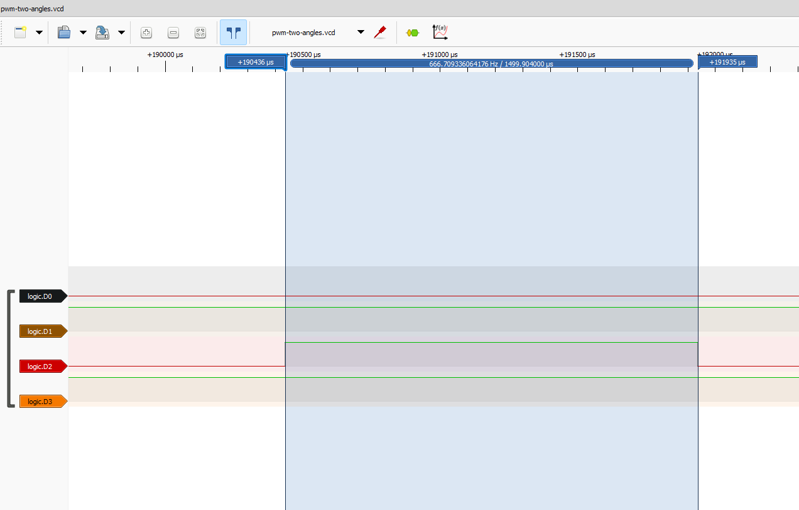
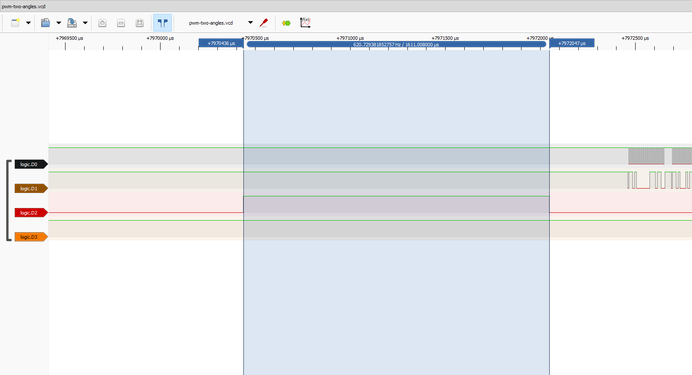
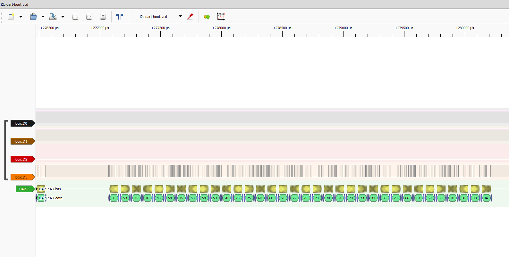
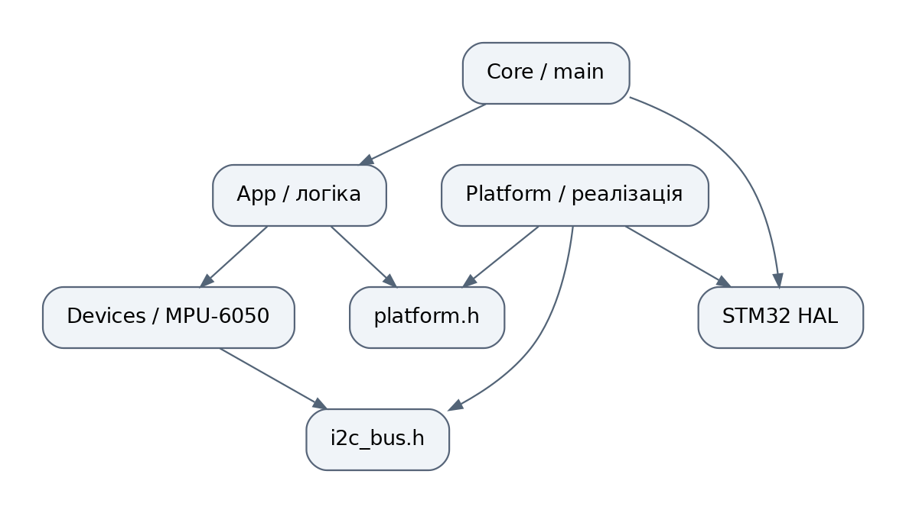
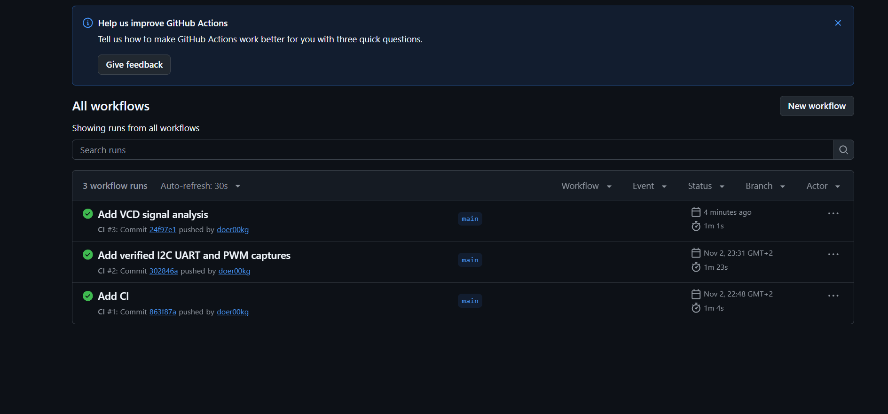

# Звіт з лабораторної роботи №2

**Дисципліна:** Системне програмування вбудованих систем  
**Тема:** Інтеграція сенсорної підсистеми: схема підключення, верифікація інтерфейсів логічним аналізатором, архітектура програмного проєкту  
**Проєкт:** Motion-Mirror  
**Виконав:** Григорчук Денис Сергійович, група ІО-31  
**Перевірив:** Гордієнко Нікіта Юрійович  
**КПІ ім. Ігоря Сікорського, ФІОТ**  
Київ — 2026

## 1. Мета роботи

Розробити схему підключення сенсорів і виконавчих пристроїв до STM32, перевірити роботу інтерфейсів логічним аналізатором, розділити програмний проєкт на шари та налаштувати автоматичне тестування і збірку прошивки.

## 2. Опис проєкту

Motion-Mirror повторює нахил руки оператора за допомогою сервоприводу. Датчик MPU-6050 вимірює прискорення та кутову швидкість. Мікроконтролер обробляє дані комплементарним фільтром і формує PWM-сигнал. Потенціометр регулює підсилення руху, кнопка перемикає режими LIVE та HOLD. Повідомлення про роботу системи передаються через UART.

Робота виконана за формою B у симуляторі Wokwi на платі NUCLEO-C031C6 з мікроконтролером STM32C031C6T6. Використано STM32 HAL, без Arduino і RTOS.

Репозиторій: https://github.com/doer00kg/sysprog2

## 3. Аргументація архітектурних рішень

### 3.1. Вибір компонентів та підключення

| **Компонент**       | **Піни STM32**       | **Інтерфейс** |
|---------------------|----------------------|---------------|
| MPU-6050            | PB8 (SCL), PB9 (SDA) | I2C1, AF6     |
| Сервопривід SG92R   | PA6                  | TIM3_CH1, AF1 |
| Потенціометр 10 кОм | PA0                  | ADC1_IN0      |
| Кнопка              | PC13                 | GPIO, pull-up |
| UART (ST-LINK VCP)  | PA2 (TX), PA3 (RX)   | USART2, AF1   |

Для MPU-6050 обрано I2C: дві сигнальні лінії дозволяють читати та записувати регістри датчика. Адреса пристрою 0x68, регістр WHO_AM_I (0x75) має повертати 0x68. Дані акселерометра і гіроскопа читаються з 0x3B.

Для сервоприводу використано апаратний таймер TIM3. Потенціометр підключено до PA0; значення 12-бітного АЦП від 0 до 4095 перетворюється на коефіцієнт підсилення від 0,5 до 2,0.

Піни обрано за DS13867 (таблиці 12, 13, 15), UM2953 (таблиця 11) та RM0490.

### 3.2. Живлення компонентів

| **Компонент**       | **Напруга** | **Споживання**             |
|---------------------|-------------|----------------------------|
| STM32C031           | 3,3 В       | Близько 3,4 мА             |
| MPU-6050            | 3,3 В       | Близько 3,8 мА             |
| Потенціометр 10 кОм | 3,3 В       | 0,33 мА                    |
| Сервопривід         | 5 В         | Сотні мА під навантаженням |

Сумарне розрахункове споживання STM32, датчика та потенціометра становить близько 8 мА без інших компонентів плати. На реальному стенді сервопривід слід живити від окремого джерела 5 В зі спільною землею. У Wokwi електричні характеристики живлення повністю не моделюються, тому піковий струм і просідання напруги потрібно перевіряти на фізичному обладнанні.

### 3.3. Налаштування периферії

Тактова частота STM32 — 48 МГц. Для TIM3: PSC = 47, ARR = 19999. Тривалість одного відліку — 1 мкс.

T = (47 + 1) × (19999 + 1) / 48000000 = 0,02 с.

Частота PWM становить 50 Гц, ширина імпульсу — 1000–2000 мкс, нейтральне положення — 1500 мкс. UART налаштовано на 115200 бод, 8N1. MPU-6050 налаштовано на частоту вибірки 200 Гц, акселерометр ±2g, гіроскоп ±250 °/с.

### 3.4. Відхилені варіанти підключення

Розглядались PB6/PB7 для I2C, але на Nucleo зручніше використати PB8/PB9, виведені як SCL/SDA. Замість TIM1 обрано TIM3, оскільки для одного каналу PWM його достатньо. Живлення серво від 3,3 В відхилено через вимоги двигуна до напруги та струму. Конфліктів між вибраними пінами немає, DMA не використовується, контакти SWD не зайняті.

### 3.5. Схема підключення

MPU-6050: VCC → 3,3 В, GND → GND, SCL → PB8, SDA → PB9. Потенціометр: крайні контакти → 3,3 В і GND, сигнальний → PA0. Серво: PWM → PA6, GND → спільна земля; для фізичного стенда — окремі 5 В. Кнопка: PC13 → кнопка → GND, внутрішня підтяжка pull-up.

| **Канал аналізатора** | **Сигнал** | **Пін** |
|-----------------------|------------|---------|
| D0                    | I2C SCL    | PB8     |
| D1                    | I2C SDA    | PB9     |
| D2                    | PWM        | PA6     |
| D3                    | UART TX    | PA2     |

Повна схема зберігається у diagram.json. Детальний опис контактів та параметрів шин наведено у docs/pinout.md.

## 4. Перевірка роботи пристроїв

Після запуску прошивки виконується самотестування. Результати передаються через UART у форматі key=value.

| **Параметр**                | **Результат**          |
|-----------------------------|------------------------|
| WHO_AM_I                    | 0x68                   |
| Модуль прискорення у спокої | 1000 mg                |
| Температура датчика         | 24 °C                  |
| Початковий PWM              | 1500 мкс               |
| Самоперевірки               | 8 успішних, 0 невдалих |



Рисунок 1 — Самотестування у Wokwi.

При зміні нахилу значення servo_us змінювалось від 1500 до 1634 мкс, а при нахилі в інший бік — до 1439 мкс. При обертанні потенціометра змінювався gain_x100. У режимі HOLD нахил змінювався, але PWM залишався 1382 мкс. Повторне натискання кнопки відновило режим LIVE.

## 5. Аналіз сигналів логічним аналізатором

Для аналізу використано логічний аналізатор Wokwi та PulseView. Запис починався разом із симуляцією, без окремого тригера. VCD зберігає часові позначки переходів, фіксована частота дискретизації під час запису не задавалася.

| **Файл**           | **Тривалість** |
|--------------------|----------------|
| i2c-uart-boot.vcd  | 4,610 с        |
| pwm-two-angles.vcd | 9,758 с        |

Для повторення запису потрібно запустити симуляцію, дочекатися самотесту, змінити нахил MPU-6050 для другого запису та зупинити симуляцію. Файли відкриваються в PulseView.

### 5.1. Аналіз I2C

Декодер: SCL = D0, SDA = D1. На записі є звернення до адреси 0x68 та регістра 0x3B. Період SCL 10,000 мкс, частота 100,0 кГц. За TIMINGR розраховано близько 102 кГц, у Wokwi отримано номінальні 100 кГц.



Рисунок 2 — Декодування I2C у PulseView.

#### Ручне декодування

У початковій транзакції (START близько 16,106 мс) на зростаючих фронтах SCL біти SDA 1 1 0 1 0 0 0 0 дають 11010000 = 0xD0. Перші сім бітів — адреса 0x68, останній R/W = 0 (запис). Дев’ятий біт 0 означає ACK. Наступні біти 0 1 1 1 0 1 0 1 дають 0x75 (WHO_AM_I), після них також ACK. START — спад SDA при високому SCL, STOP — підйом SDA при високому SCL. Тривалість транзакції близько 198 мкс. На рисунку 2 показано пізніше робоче читання 0x3B.

#### Виявлена аномалія

У першому записі виявлено чотири паузи низького SCL тривалістю 50,452–50,516 мс, у другому — п’ять. Перед паузами передано адресу та байт регістра з ACK, після чого тактові імпульси зникають. Тривалість близька до таймауту HAL (50 мс). Це узгоджується з лічильниками самотесту retries=4 та i2c_err=0x20. Чотири паузи займають близько 202 мс. Для відновлення реалізовано повтор транзакції після перезапуску I2C. Точну причину поведінки моделі Wokwi не встановлено.

### 5.2. Аналіз PWM

Для вимірювання використано канал D2. Період PWM залишається сталим, а ширина імпульсу змінюється відповідно до нахилу датчика.

| **Параметр**        | **Виміряне значення** |
|---------------------|-----------------------|
| Період              | 20 мс                 |
| Частота             | 50 Гц                 |
| Початкова ширина    | 1499,904 мкс          |
| Ширина після нахилу | 1611,008 мкс          |
| Різниця             | 111,104 мкс           |



Рисунок 3 — Початкова ширина PWM.



Рисунок 4 — Ширина PWM після зміни нахилу.

### 5.3. Аналіз UART

Декодер UART: RX = D3, 115200 бод, 8N1. Байти 53 45 4C 46 54 45 53 54 відповідають слову SELFTEST, а 70 61 73 73 3D 38 20 66 61 69 6C 3D 30 — повідомленню pass=8 fail=0. Це підтверджує передавання результатів самотесту.



Рисунок 5 — Декодування UART у PulseView.

### 5.4. Перевірка АЦП

Потенціометр є аналоговим пристроєм, цифрового трафіку на виході немає. Роботу АЦП перевірено через gain_x100 у UART. Для фіксації моменту вимірювання можна перемикати вільний GPIO до і після platform_adc_read() та записувати його логічним аналізатором. У наявних VCD такого сигналу немає.

### 5.5. Вимірювання часу реакції

Для FR-10 визначено час між завершенням читання IMU зі зміненим прискоренням (5954,086 мс) і початком PWM з новою шириною (5990,436 мс).

Затримка = 5990,436 − 5954,086 = 36,350 мс.

Для виміряного переходу затримка менша за 50 мс. Для інших кроків нахилу час може відрізнятися через фільтр і мертву зону.

Числовий аналіз частот і ширин імпульсів повторюється командою `python scripts/analyze_captures.py`. Результати та пояснення зберігаються у docs/captures/analysis.md і docs/captures/analysis_output.txt.

## 6. Архітектура програмного проєкту

| **Шар**  | **Призначення**                         |
|----------|-----------------------------------------|
| Core     | Код CubeMX, ініціалізація і запуск      |
| Drivers  | STM32 HAL та CMSIS                      |
| Platform | Адаптація до плати, доступ до периферії |
| Devices  | Драйвер MPU-6050                        |
| App      | Фільтрація, керування, самотест         |
| tests    | Хостові тести                           |



Рисунок 6 — Компонентна діаграма архітектури прошивки.

Драйвер MPU-6050 не залежить напряму від HAL. Для доступу до шини використано i2c_bus_t з функціями читання, запису та контекстом. Один драйвер працює як у прошивці, так і в хостових тестах. Прив’язки пінів зберігаються у Platform/board.h. Зміни в коді CubeMX виконуються в секціях USER CODE.

Скрипт scripts/check_deps.py перевіряє заборонені залежності шарів Devices і App. Використано STM32C0 HAL v1.0.1. Основний цикл без RTOS планує задачі за HAL_GetTick; операції HAL можуть блокувати виконання до завершення транзакції або таймауту.

## 7. Збірка та тестування

Збірка виконується у Docker за допомогою arm-none-eabi-gcc. Перевірка залежностей, тести та збірка запускаються командами PowerShell:

```powershell
powershell -ExecutionPolicy Bypass -File scripts/dev.ps1 all
powershell -ExecutionPolicy Bypass -File scripts/dev.ps1 coverage
```

### 7.1. Результати тестування

| **Файл**        | **Перевірки** | **Помилки** |
|-----------------|---------------|-------------|
| test_mpu6050.c  | 65            | 0           |
| test_motion.c   | 25            | 0           |
| test_debounce.c | 18            | 0           |
| test_app.c      | 16            | 0           |
| Разом           | 124           | 0           |

Тести перевіряють ініціалізацію датчика, читання регістрів, помилки I2C, перетворення даних, комплементарний фільтр, сервопривід та антидребезг. Використано власний мінімальний каркас із підробленими реалізаціями шини і платформи, без автоматичної генерації mock-об’єктів. Проблеми стартових I2C-транзакцій виявлено в симуляції.

### 7.2. Тестування на основі запису VCD

Тест test_read_raw_from_capture у test_mpu6050.c використовує 14 байтів із реального запису:

00 00 00 00 40 00 EF 5C 00 00 00 00 00 00.

Прискорення по Z — 16384 LSB (1g), по X і Y — 0, температура близько 24 °C, показники гіроскопа — 0. Це відповідає показникам самотесту.

Окремим хостовим тестом перевірено втрату зв’язку з датчиком під час роботи: сервопривід повертається до 1500 мкс, після відновлення зв’язку керування продовжується.

### 7.3. Покриття тестами

| **Модуль** | **Покриття рядків (gcov)** |
|------------|----------------------------|
| mpu6050.c  | 100%                       |
| motion.c   | 100%                       |
| debounce.c | 100%                       |
| app.c      | 98,1%                      |

Наведено максимум покриття рядків за тестовими наборами. Це не означає, що перевірено всі комбінації вхідних даних.

### 7.4. Результат збірки

| **Секція** | **Розмір, байт** |
|------------|------------------|
| text       | 27636            |
| data       | 132              |
| bss        | 2092             |

Фінальна локальна збірка і перевірка архітектурних залежностей успішні. GitHub Actions налаштовано для автоматичної збірки і тестів; попередні запуски CI успішні.



Рисунок 7 — Попередні успішні запуски GitHub Actions.

## 8. Журнал проблем

| **Проблема**                   | **Причина**                               | **Вирішення**                        |
|--------------------------------|-------------------------------------------|--------------------------------------|
| Відсутні LL-заголовки          | Неповний набір HAL                        | Додано заголовки v1.0.1              |
| Помилки збірки ADC і TIM       | Відсутні модулі HAL                       | Додано модулі і конфігурацію         |
| Артефакти збірки в Git         | Відсутні правила ігнорування              | Оновлено .gitignore                  |
| Помилки ініціалізації MPU-6050 | Таймаути I2C; точна першопричина невідома | Повтор транзакцій та відновлення I2C |
| Кнопка плати не дає вводу      | Особливості моделі Wokwi                  | Окрема кнопка на PC13                |
| VCD не в очікуваній папці      | Налаштування шляху запису                 | Повторний запис у docs/captures      |

Коміти з виправленнями:

Модулі HAL: https://github.com/doer00kg/sysprog2/commit/f416d82

Правила .gitignore: https://github.com/doer00kg/sysprog2/commit/6493345

Периферія та кнопка: https://github.com/doer00kg/sysprog2/commit/40e5b59

Відновлення I2C: https://github.com/doer00kg/sysprog2/commit/03cdb5b

Оновлення записів: https://github.com/doer00kg/sysprog2/commit/302846a

## 9. Хід виконання роботи

1.  Налаштував Docker та початковий проєкт STM32.

2.  Підключив ADC і TIM3 для потенціометра та сервоприводу.

3.  Реалізував драйвер MPU-6050, фільтрацію та хостові тести.

4.  Розділив код на шари та створив схему Wokwi.

5.  Виконав діагностику помилок I2C та реалізував відновлення транзакцій.

6.  Записав VCD, проаналізував сигнали у PulseView та налаштував GitHub Actions.

7.  Додав тест із даними VCD і виконав фінальну перевірку прошивки.

## 10. Висновок

Під час лабораторної роботи розроблено сенсорну підсистему Motion-Mirror. MPU-6050, потенціометр, кнопка і сервопривід підключені до STM32 та перевірені в Wokwi. PulseView підтвердив I2C 100 кГц, UART 115200 бод і PWM 50 Гц. Ширина PWM змінюється відповідно до нахилу, затримка реакції для одного переходу становила 36,35 мс.

Поділ на шари дозволив тестувати драйвер і прикладну логіку без фізичного обладнання. Усі 124 перевірки пройшли, покриття основних модулів становить 98,1–100%. Основні завдання виконано. Електричні характеристики та поведінка за інших умов потребують перевірки на реальному обладнанні.

## 11. Використані джерела

1. STMicroelectronics. STM32C031x4/x6 Datasheet, DS13867.

2. STMicroelectronics. STM32C0x1 Reference Manual, RM0490.

3. STMicroelectronics. STM32 Nucleo-64 User Manual, UM2953.

4. InvenSense. MPU-6000/MPU-6050 Product Specification.

5. InvenSense. MPU-6000/MPU-6050 Register Map and Descriptions.

6. Документація Wokwi: https://docs.wokwi.com/

7. Репозиторій Motion-Mirror: https://github.com/doer00kg/sysprog2
